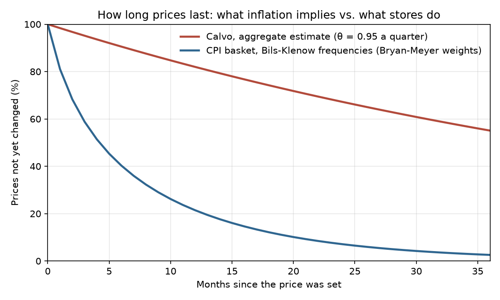
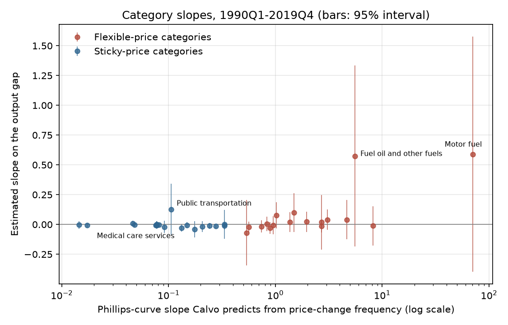
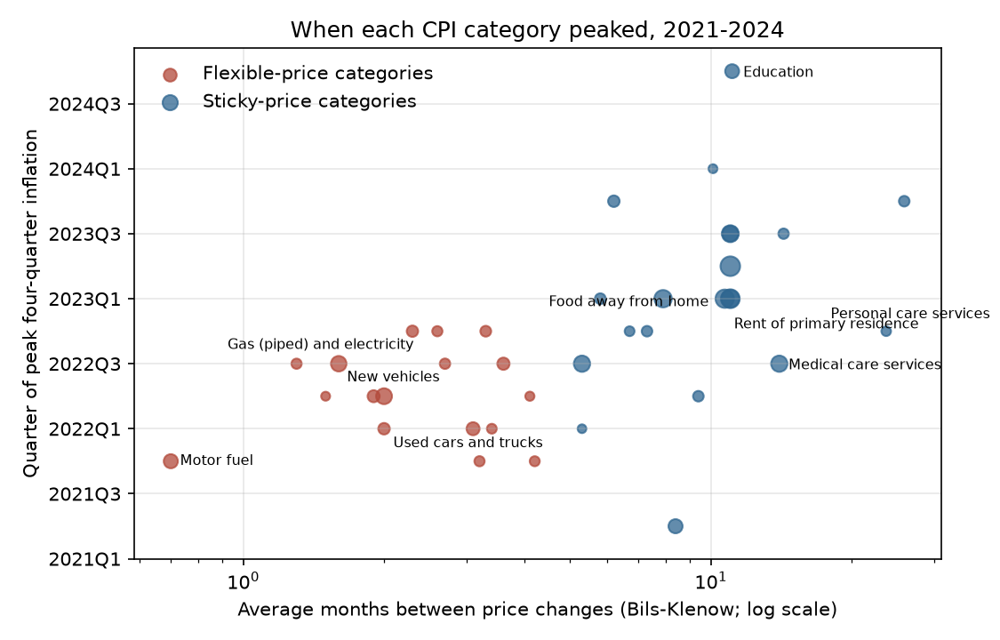

# How Long Prices Stick

### In 1983 Guillermo Calvo asked what inflation looks like when sellers change their prices only now and then, at random moments. I put his answer to sixty years of American prices.

---

The price on the sign outside a Shell or Exxon station moves every few weeks. The price of a haircut at the
barbershop down the street can sit unchanged for two years. Mark Bils and Peter Klenow measured this from the
raw records behind the Consumer Price Index, and in the version of their numbers that Michael Bryan and Brent
Meyer of the Federal Reserve laid out in 2010, motor fuel changes price on average every 0.7 months, a
restaurant meal every 10.7 months, medical care services every 14 months and haircuts and other personal care
services every 23.7 months. Bryan and Meyer add that coin-operated laundries change price about once every six
and a half years.

Those waits matter well beyond the shop counter. If most prices are stuck for months at a time, then when the
Federal Reserve raises interest rates, or when the cost of labor jumps, the price level cannot respond all at
once. It drifts, and in the meantime output and jobs take the strain. Many of the models that central banks use
to set interest rates build that drift on a single assumption, written down by an Argentine economist at
Columbia University in 1983. This repository checks whether the assumption fits the prices Americans actually
pay.

---

## Two numbers that describe sticky prices

Calvo's device reduces price stickiness to one number. In each period, a given seller is allowed to reset its
price with probability $`1-\theta`$ and is stuck with its old price with probability $`\theta`$, whatever has
happened and however long the price has already stood. The waiting time is then geometric, and its average
follows directly:

```math
\Pr(\text{price lasts exactly } k \text{ periods}) = (1-\theta)\,\theta^{\,k-1},
\qquad
\mathbb{E}[\text{duration}] = \frac{1}{1-\theta}
```

Bils and Klenow report the average number of months between price changes, $`D`$. If price changes arrive at a
constant rate, the chance that a price survives a whole quarter is $`\theta = e^{-3/D}`$. For restaurant meals,
with $`D = 10.7`$ months:

```math
\theta = e^{-3/10.7} = 0.76,
\qquad
\frac{1}{1-\theta} = \frac{1}{0.245} = 4.1 \text{ quarters}
```

The second number links stickiness to inflation. It is the slope of what economists call the New Keynesian
Phillips curve. With $`\beta`$ the quarterly discount factor (0.99 throughout, the standard value), the curve
and its slope are:

```math
\pi_t = \beta\,\mathbb{E}_t\,\pi_{t+1} + \kappa\,\hat{s}_t,
\qquad
\kappa = \frac{(1-\theta)(1-\beta\theta)}{\theta}
```

Here $`\pi_t`$ is inflation this quarter, $`\mathbb{E}_t\,\pi_{t+1}`$ is the inflation firms expect next quarter,
and $`\hat{s}_t`$ is real marginal cost, the cost of producing one more unit measured against its normal level.
In the aggregate data it is measured, following the literature, as the labor share of income in the nonfarm
business sector, in log deviation from its average. A small $`\kappa`$ means prices barely react to costs this
quarter, and the slope falls very fast as prices get stickier.

| Average months between price changes | Quarterly chance a price stays put, θ | Slope κ |
|---|---|---|
| 0.7 (motor fuel) | 0.01 | 70.7 |
| 4.3 (the median category in Bils and Klenow) | 0.50 | 0.51 |
| 23.7 (haircuts and other personal care services) | 0.88 | 0.017 |

A category whose prices change every three weeks should pass a cost increase straight through. One whose prices
change every two years should barely move in the quarter the cost rises, then keep catching up for years.

---

## Guillermo Calvo's shortcut

Guillermo Calvo was born in Buenos Aires in 1941, took his doctorate at Yale in 1974 and taught at Columbia
from 1973 to 1986. He is better known today for his work on emerging-market crises. In 1998 he published a
paper on "sudden stops," the abrupt halts in foreign capital that can push a country into crisis, and from
2001 to 2006 he was chief economist of the Inter-American Development Bank. He is now back at
Columbia's School of International and Public Affairs.

The 1983 paper, "Staggered Prices in a Utility-Maximizing Framework," was a piece of technical engineering. In
the late 1970s Edmund Phelps and John Taylor had shown that if wages or prices are set for fixed stretches and
the setting dates are staggered across the economy, monetary policy can move output even when everyone forms
expectations rationally. Their contracts were awkward to work with, because the economy had to keep track of
every cohort of contracts still in force. Calvo replaced the fixed contract with a random one. Each firm
receives a signal, at a constant rate, that it may change its price, and the signal arrives regardless of how
long the current price has stood. Because the waiting time has no memory, the whole history of past prices
collapses into the current price level, and the model's dynamics shrink to a single equation. The paper is
written in continuous time and contains no data. Most economists meet it in the discrete-time version used
today, and Crossref records more than 5,000 citations of it.

The derivation that turned Calvo's device into the curve above takes five lines. Assume each firm has some
monopoly power, facing a demand curve with a constant elasticity, so that a firm free to choose would set its
price at a fixed log markup $`\mu`$ over nominal marginal cost $`mc^n`$, and assume every firm has the same
marginal cost, as it does under constant returns to scale. Work in logs, around zero inflation. A fraction
$`1-\theta`$ of firms, drawn at random, reset to the same price $`p^*_t`$, and the rest keep last period's
price, so the price level $`p_t`$ evolves as in the first line:

```math
\begin{aligned}
p_t &= \theta\,p_{t-1} + (1-\theta)\,p^*_t \\
p^*_t &= (1-\beta\theta)\textstyle\sum_{k\ge 0}(\beta\theta)^k\,\mathbb{E}_t\!\left[\mu + mc^n_{t+k}\right] \\
p^*_t &= (1-\beta\theta)(\mu + mc^n_t) + \beta\theta\,\mathbb{E}_t\,p^*_{t+1} \\
\pi_t &= \tfrac{1-\theta}{\theta}\,(p^*_t - p_t) \\
\pi_t &= \beta\,\mathbb{E}_t\,\pi_{t+1} + \tfrac{(1-\theta)(1-\beta\theta)}{\theta}\,\hat{s}_t
\end{aligned}
```

The second line carries the economics. A firm that knows its price may be stuck for a while sets it as a markup
over a weighted average of the marginal costs it expects over the life of the price, with weights that shrink
at rate $`\beta\theta`$; the third line writes the same sum recursively. The fourth line is the first
rearranged. Real marginal cost $`\hat{s}_t = \mu + mc^n_t - p_t`$ is the gap between where firms
would like prices to be and where they are. Subtracting $`p_t`$ from both sides of the third line and
replacing each gap between reset price and price level with the fourth line, at $`t`$ and at $`t+1`$, gives the
last line, which says inflation today equals expected inflation
tomorrow plus a push from that gap that weakens as prices get stickier.

Market power is what makes the arrangement survivable. A seller in a perfectly competitive market whose price
sits above everyone else's loses every customer, so it cannot afford to wait for Calvo's signal. A seller with a
differentiated product and a downward-sloping demand curve loses some sales but not all, which is why the
model's firms are monopolistic competitors and why the markup $`\mu`$ appears in their pricing rule.

The objection that has followed the paper for forty years is that nobody believes the signal is really random.
State-dependent models, beginning with the menu-cost papers by Robert Barro and by Eytan Sheshinski and Yoram
Weiss that Calvo himself cited, say firms change prices when the gap between their price and the price they want
gets large enough, so the chance of a change should rise with a price's age and with inflation. Martin
Eichenbaum of Northwestern and Jonas Fisher of the Chicago Fed answered in 2003 that the two kinds of model give similar results
for many policy experiments in a moderate-inflation economy like the United States. The sharper complaint is
about magnitude. Fitted to aggregate inflation, their estimates implied that firms wait six to 11 quarters
before reoptimizing a price, while the micro data say most prices change within a year. Eichenbaum and Fisher
also found the model's restrictions strongly rejected for three of their four inflation measures when the
weighting matrix imposed all of them, and argued that allowing for measurement error in inflation, a short lag
before new prices take effect, or a change in monetary policy around 1979 removes much of that evidence.

---

## How I tested it

Calvo's paper has no table to replicate, so I replicated the test that the profession built for it. Eichenbaum
and Fisher's 2003 version, which follows Jordi Galí and Mark Gertler's 1999 method, estimates $`\theta`$ by the
generalized method of moments (GMM). Under the model, the error a firm makes in forecasting next quarter's
inflation must be unpredictable from anything it knew this quarter, which gives one moment condition for each
variable in that information set:

```math
\begin{aligned}
&\mathbb{E}\Big[\big(\theta\hat{\pi}_t - \beta\theta\hat{\pi}_{t+1}
 - (1-\theta)(1-\beta\theta)\hat{s}_t\big)\,X_t\Big] = 0 \\
&X_t = \big(1,\ Z_t,\ Z_{t-1},\ Z_{t-2},\ Z_{t-3}\big), \qquad \beta = 0.99
\end{aligned}
```

Here $`\hat{\pi}_t`$ is quarterly inflation minus its sample mean, $`\hat{s}_t`$ is the log labor share
minus its sample mean, and $`Z_t`$ holds their six instruments, the labor share, quadratically detrended real
GDP, inflation, commodity-price inflation, the long-minus-short Treasury spread, and nominal wage growth in
nonfarm business. Where FRED lacks their exact series I substituted the producer price index for all
commodities for the Commodity Research Bureau index, the ten-year yield for their composite of bonds of ten
years and longer, and hourly compensation for total compensation. With 25 instruments and one parameter, Hansen's $`J`$ statistic tests the 24 overidentifying
restrictions, and the null hypothesis is that Calvo's restrictions hold. The weighting matrix is the Newey-West
long-run covariance with $`L = 0`$ lags (no serial correlation, which is what the model implies) or $`L = 12`$ (Galí and
Gertler's choice), and standard errors come from the same matrix. I kept their sample, 1959 to 2001, their four
inflation measures and their $`\beta`$, then ran the identical test through 2019 and through the latest data.
All series come from FRED.

For the extension I went down to the 45 CPI components in Bryan and Meyer's table, each with its Bils-Klenow
duration and CPI weight. Seven have no index on FRED, among them motor vehicle insurance and car rental, which
leaves 38 categories covering 95.9% of the basket. For each I estimated its own Phillips curve on the output gap
(real GDP against the Congressional Budget Office's potential), with lagged gaps and lagged own inflation as
instruments and Newey-West standard errors with four lags, over 1990 to 2019, a window I fixed in advance:

```math
\begin{aligned}
\pi_{it} - \beta\,\pi_{i,t+1} &= a_i + \kappa_i\,x_t + e_{it} \\
\hat{\kappa}_i &= c_0 + c_1 \ln \kappa_i^{\text{Calvo}}(D_i) + u_i,
\qquad H_0\colon c_1 = 0
\end{aligned}
```

Here $`\pi_{it}`$ is category $`i`$'s quarterly inflation in percent, $`x_t`$ is the output gap in percent, $`a_i`$
is a category constant and $`\kappa_i^{\text{Calvo}}(D_i)`$ is the slope Calvo's formula gives for a category
whose prices last $`D_i`$ months. The second line asks whether the estimated slopes rise with the predicted ones;
it is weighted by CPI importance with heteroskedasticity-robust (HC1) standard errors. For the flexible and
sticky groups as a whole I ran the first line on CPI-weighted group indexes, which can only be built from 1998,
when the last four category series begin, so those two regressions cover 1998Q4 to 2019Q4. Separately I
found the quarter in which each category's four-quarter inflation peaked between 2021 and 2024 and regressed it
on $`\ln D_i`$ in the same way.

---

## Fitted to inflation, Calvo's model says prices last five years

The rebuilt Eichenbaum and Fisher table comes out close to theirs in the cases that carry their argument.

| Inflation measure, 1959–2001, L = 0 | Their θ (s.e.) | Their J [p] | My θ (s.e.) | My J [p] |
|---|---|---|---|---|
| GDP deflator | 0.89 (0.03) | 49.4 [0.001] | 0.925 (0.039) | 48.3 [0.002] |
| Nonfarm business deflator | 0.86 (0.03) | 41.1 [0.01] | 0.850 (0.030) | 45.4 [0.005] |
| CPI | 0.88 (0.05) | 38.9 [0.02] | 0.873 (0.042) | 36.2 [0.05] |
| PCE deflator | 0.87 (0.02) | 44.8 [0.004] | 0.860 (0.025) | 39.6 [0.02] |

The pattern in the $`J`$ statistics also survives on today's revised data. With $`L = 0`$, Calvo's restrictions
are rejected at the 5% level for three of the four measures, and with $`L = 12`$ they are never rejected (every
p-value is above 0.96), which is the sensitivity Eichenbaum and Fisher warned about.

Extending the sample pushes the estimate up. Over 1959 to 2019, with the GDP deflator:

```math
\hat{\theta} = 0.952\ (0.027),\quad J_{24} = 52.9\ [p = 0.001],\quad N = 244,
\quad \frac{1}{1-\hat{\theta}} = 20.6 \text{ quarters}
```

That is a price fixed for 62 months on average. The other three measures give $`\hat{\theta}`$ between 0.929 and
0.945, and the 1985 to 2019 subsample gives between 0.931 and 0.968. The micro data say something entirely
different. Weighting Bryan and Meyer's 45 categories by their CPI importance, the average price lasts 7.9 months
and the median dollar of spending sits in a category whose prices last 8.4 months. Averaging each category's
$`\theta = e^{-3/D}`$ over the basket gives a quarterly $`\theta`$ of 0.59.



The gap matters more for the slope than for the duration. Plugging the two values of $`\theta`$ into
$`\kappa`$ gives 0.0030 from aggregate inflation and 0.29 from the micro frequencies, a factor of about 99.
Read literally, aggregate inflation behaves as if prices were roughly a hundred times less responsive to costs
than store-level pricing implies. Economists call this the macro-micro puzzle, and on the longer sample the
gap is wider than on Eichenbaum and Fisher's.

---

## Across the CPI basket, slopes barely follow the formula

If Calvo's mechanism were the whole story, the categories that reprice every few weeks would respond to the
business cycle dozens of times more strongly than those that reprice once a year. Weighting each group's
Calvo slope by CPI importance, the flexible-price categories should have a $`\kappa`$ about 91 times that of the
sticky-price ones. The data point the right way but weakly.

```math
\hat{\kappa}_{\text{flexible}} = 0.093\ (0.086),\qquad
\hat{\kappa}_{\text{sticky}} = -0.005\ (0.006),\qquad
\hat{c}_1 = 0.039\ (0.022),\ p = 0.07
```

The sticky categories, which include rent, restaurant meals and medical care, show essentially no response to the
output gap at all. The flexible categories respond more, but most of that is motor fuel and fuel oil, whose
estimated slopes of 0.59 and 0.57 carry standard errors of 0.50 and 0.39. Only 14 of the 38 categories have a
positive estimated slope, and the rank correlation between estimated and predicted slopes is 0.26 (p = 0.12).



The output gap is a rough stand-in for each category's marginal cost, and gasoline's cost is mostly the world
price of crude oil, which moves for reasons unrelated to American slack. The test therefore asks a lot of the
data. Even so, Calvo's formula predicts a spread of slopes across categories of several orders of magnitude, and
the data show a spread close to zero everywhere except energy.

---

## The 2021–23 inflation arrived in the order Calvo predicts

The timing of the recent inflation is a cleaner test, because it needs no measure of marginal cost. When costs
jumped across the economy in 2021, Calvo's model says the flexible categories should have spiked first and the
sticky ones should have kept rising long afterward, as each seller's turn to reprice came up. The data show that
order.

| What you buy | Months between price changes | Quarterly chance of a reset (Calvo) | Peak quarter | Peak four-quarter inflation |
|---|---|---|---|---|
| Gasoline and diesel (motor fuel) | 0.7 | 99% | 2021Q4 | 52.8% |
| Used cars and trucks | 2.0 | 78% | 2022Q1 | 39.0% |
| Meat, poultry, fish and eggs | 1.9 | 79% | 2022Q2 | 13.5% |
| New vehicles | 2.0 | 78% | 2022Q2 | 12.4% |
| Electricity and piped gas | 1.6 | 85% | 2022Q3 | 19.6% |
| Doctors, hospitals and other medical services | 14.0 | 19% | 2022Q3 | 5.8% |
| Haircuts and other personal care services | 23.7 | 12% | 2022Q4 | 6.2% |
| Restaurant meals (food away from home) | 10.7 | 24% | 2023Q1 | 8.5% |
| Rent of a primary residence | 11.0 | 24% | 2023Q1 | 8.7% |

Across all 38 categories, the CPI-weighted flexible-price group peaked on average 5.0 quarters after the start of
2021 and the sticky-price group 8.2 quarters after, with peak inflation of 20.9% against 7.6%. The regression of
peak quarter on log duration gives:

```math
\hat{d}_1 = 1.90\ (0.35),\quad p < 0.001,\qquad
\rho_{\text{Spearman}} = 0.63\ [p < 0.001],\quad N = 38
```

Going from a category that reprices every two months to one that reprices every 11 months moves the peak about
three quarters later. Owners' equivalent rent in all four census regions peaked between 2023Q1 and 2023Q3, and
education peaked last, in 2024Q4, the final quarter of the search window, so its true peak may be later. Medical care services, sticky by the micro measure, peaked early, in 2022Q3, an exception
the model does not explain.



---

## Why it matters

For consumers, the timing result explains why inflation seemed to linger after gasoline prices had already
fallen. Rent, restaurant meals and services kept rising through 2023 because their sellers were still taking
their delayed turns to catch up.

For workers, the flat slope is double-edged. A labor market can run hot for a long time without much effect on
prices, which helps employment, but the same arithmetic means bringing inflation down through slack alone takes
a lot of slack.

For smaller firms, the model's reliance on market power is the useful part. A seller can only afford to leave a
price alone if its customers will not all leave, so the stickiness Calvo describes is one face of the monopoly
power that a differentiated product or a loyal local clientele provides.

For policy, the evidence is mixed. Calvo's random clock describes the order in which prices respond to a broad
shock remarkably well, and that is what central banks most need when they judge how long a burst of inflation
will last. It describes the size of the response badly. Models that add strategic complementarity, sales and
state-dependent pricing exist to close that gap, and this data does not choose among them.

---

## Limits of this study

The micro frequencies come from Bils and Klenow's study of the CPI records as tabulated by Bryan and Meyer, and
how temporary sales are treated matters a great deal. Emi Nakamura and Jón Steinsson found that excluding sales
roughly halves the measured frequency, to 9 to 12% of prices a month against 19 to 20% when sales count, so
frequencies that count sales make regular prices look more flexible than they are. Bils and Klenow did not measure rents or owners'
equivalent rent, so Bryan and Meyer gave them the 11 months Bils and Klenow found for housing at school. Labor share and the output gap are standard but crude proxies for
real marginal cost, and a different proxy can change $`\hat{\theta}`$ considerably. Seven categories, about 4% of
the basket, are missing. The timing test uses peaks, which are noisy for categories with flat or double-peaked
paths, and a category's peak also reflects when its particular shock arrived, so supply problems in used cars
or energy can produce an early peak for reasons that have nothing to do with how often prices are reset. None of
these results show that sellers actually follow a random clock, only that some of the model's predictions fit
and others do not.

---

## Further reading

- [TECHNICAL.md](TECHNICAL.md) has the data, method rules, every test statistic and the reproduction commands.
- [results/FINDINGS.md](results/FINDINGS.md) summarizes the results and reproduces every table.
- [METHODS_REVIEW.md](METHODS_REVIEW.md) reviews the original paper's assumptions, formal results and testability.
- The original paper is Guillermo A. Calvo, "Staggered Prices in a Utility-Maximizing Framework," *Journal of
  Monetary Economics* 12(3), 1983, pp. 383–398.
- The benchmark test is Martin Eichenbaum and Jonas D. M. Fisher, "Testing the Calvo model of sticky prices,"
  *Economic Perspectives*, Federal Reserve Bank of Chicago, 2Q/2003.
- Price-change frequencies are from Michael F. Bryan and Brent Meyer, "Are Some Prices in the CPI More Forward
  Looking than Others? We Think So," Federal Reserve Bank of Cleveland *Economic Commentary* 2010-2, Table 1,
  based on Mark Bils and Peter J. Klenow, "Some Evidence on the Importance of Sticky Prices," *Journal of
  Political Economy*, 2004.
- Aggregate prices, labor share, compensation, GDP, potential GDP, interest rates and commodity prices are from
  FRED (Federal Reserve Bank of St. Louis), downloaded November 1, 2026. The CPI component indexes are the Bureau
  of Labor Statistics series as republished on FRED.

*Brendyn Beasley*
