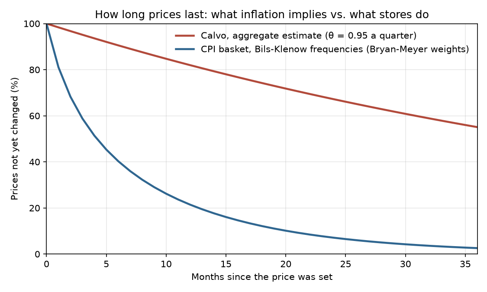
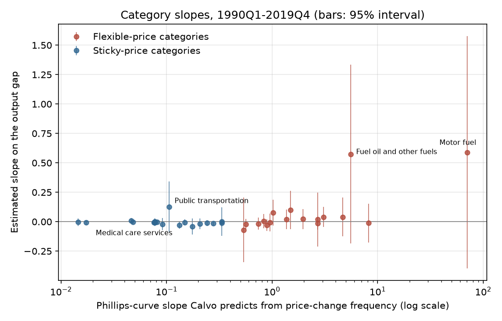
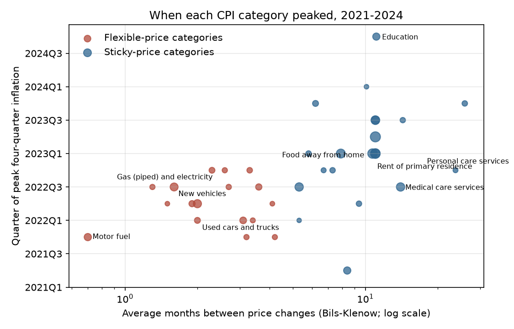

# Calvo (1983) on modern data: findings

## In plain English

In 1983 Guillermo Calvo modeled price stickiness as a random clock. Each seller gets a chance to change its price
with a fixed probability each period, however long the price has stood. This repository tests that model on US
data from 1959 to 2026.

- **Fitted to inflation, the model says prices are fixed for about five years.** The aggregate estimate of the
  quarterly chance a price stays put is 0.95 over 1959–2019, against 0.59 implied by how often prices of goods
  such as gasoline, new cars, restaurant meals and haircuts actually change in the CPI records. The model's
  Phillips curve is about 99 times flatter than the micro data imply.
- **Across the CPI basket, responsiveness to the business cycle barely follows the formula.** Gasoline and heating
  oil respond most, as the model predicts, but rent, restaurant meals and medical services show almost no response
  at all, and the overall ordering is weak (rank correlation 0.26, p = 0.12).
- **The 2021–23 inflation arrived in the order the model predicts.** Motor fuel peaked in 2021Q4 and used cars in
  2022Q1; restaurant meals and rent peaked in 2023Q1, owners' equivalent rent through 2023Q3 and education in
  2024Q4. Stickier categories peaked later (rank correlation 0.63, p < 0.001).

A fuller account is in the [README](../README.md). The rest of this page is every table the scripts produced.

**Key to the labels.** *θ (theta)* = the quarterly probability that a price is not changed. *L* = lags in the
Newey-West weighting matrix. *J, J_p* = Hansen's overidentification statistic (24 degrees of freedom) and its
p-value. *duration_quarters* = 1/(1 − θ). *slope_kappa, calvo_kappa* = (1 − θ)(1 − βθ)/θ with β = 0.99.
*kappa_hat* = estimated slope of category inflation on the CBO output gap. *months_between_changes* = Bils and
Klenow's average months between price changes, from Bryan and Meyer (2010), Table 1. *relative_importance* = CPI
weight in that table. *Flexible/sticky* = Bryan and Meyer's split at 4.3 months. NFB = nonfarm business.

## 1. Aggregate GMM estimates (`nkpc_gmm_estimates.csv`)

The 1959Q1–2001Q4 rows rebuild Eichenbaum and Fisher (2003), Table 1, panel A; the comparison with their
published numbers is in `ef2003_table1_comparison.csv` and in [TECHNICAL.md](../TECHNICAL.md).

| sample | inflation | L | n_quarters | theta | theta_se | J | J_p | duration_quarters | slope_kappa |
|---|---|---|---|---|---|---|---|---|---|
| 1959Q1-2001Q4 (Eichenbaum-Fisher) | GDP deflator | 0 | 172 | 0.925 | 0.039 | 48.3 | 0.002 | 13.4 | 0.0068 |
| 1959Q1-2001Q4 (Eichenbaum-Fisher) | GDP deflator | 12 | 172 | 0.977 | 0.049 | 11.0 | 0.989 | 43.9 | 0.0008 |
| 1959Q1-2001Q4 (Eichenbaum-Fisher) | NFB deflator | 0 | 172 | 0.850 | 0.030 | 45.4 | 0.005 | 6.6 | 0.0282 |
| 1959Q1-2001Q4 (Eichenbaum-Fisher) | NFB deflator | 12 | 172 | 0.695 | 0.018 | 12.8 | 0.969 | 3.3 | 0.1365 |
| 1959Q1-2001Q4 (Eichenbaum-Fisher) | CPI | 0 | 172 | 0.873 | 0.042 | 36.2 | 0.052 | 7.9 | 0.0199 |
| 1959Q1-2001Q4 (Eichenbaum-Fisher) | CPI | 12 | 172 | 0.921 | 0.024 | 12.4 | 0.975 | 12.6 | 0.0077 |
| 1959Q1-2001Q4 (Eichenbaum-Fisher) | PCE deflator | 0 | 172 | 0.860 | 0.025 | 39.6 | 0.024 | 7.1 | 0.0243 |
| 1959Q1-2001Q4 (Eichenbaum-Fisher) | PCE deflator | 12 | 172 | 0.918 | 0.019 | 12.2 | 0.978 | 12.2 | 0.0082 |
| 1959Q1-2019Q4 | GDP deflator | 0 | 244 | 0.952 | 0.027 | 52.9 | 0.001 | 20.6 | 0.0030 |
| 1959Q1-2019Q4 | GDP deflator | 12 | 244 | 0.977 | 0.020 | 14.9 | 0.925 | 43.0 | 0.0008 |
| 1959Q1-2019Q4 | NFB deflator | 0 | 244 | 0.929 | 0.025 | 49.3 | 0.002 | 14.0 | 0.0062 |
| 1959Q1-2019Q4 | NFB deflator | 12 | 244 | 0.972 | 0.022 | 16.2 | 0.881 | 35.2 | 0.0011 |
| 1959Q1-2019Q4 | CPI | 0 | 244 | 0.945 | 0.042 | 38.6 | 0.030 | 18.2 | 0.0037 |
| 1959Q1-2019Q4 | CPI | 12 | 244 | 0.979 | 0.038 | 15.9 | 0.891 | 47.3 | 0.0007 |
| 1959Q1-2019Q4 | PCE deflator | 0 | 244 | 0.943 | 0.030 | 42.2 | 0.012 | 17.5 | 0.0041 |
| 1959Q1-2019Q4 | PCE deflator | 12 | 244 | 0.984 | 0.038 | 16.2 | 0.881 | 64.3 | 0.0004 |
| 1985Q1-2019Q4 | GDP deflator | 0 | 140 | 0.968 | 0.040 | 37.7 | 0.037 | 31.0 | 0.0014 |
| 1985Q1-2019Q4 | GDP deflator | 12 | 140 | 0.942 | 0.010 | 10.6 | 0.992 | 17.3 | 0.0041 |
| 1985Q1-2019Q4 | NFB deflator | 0 | 140 | 0.938 | 0.030 | 38.0 | 0.034 | 16.1 | 0.0047 |
| 1985Q1-2019Q4 | NFB deflator | 12 | 140 | 0.974 | 0.026 | 10.2 | 0.994 | 39.0 | 0.0009 |
| 1985Q1-2019Q4 | CPI | 0 | 140 | 0.931 | 0.038 | 33.4 | 0.096 | 14.5 | 0.0058 |
| 1985Q1-2019Q4 | CPI | 12 | 140 | 0.954 | 0.020 | 10.3 | 0.993 | 22.0 | 0.0026 |
| 1985Q1-2019Q4 | PCE deflator | 0 | 140 | 0.956 | 0.043 | 29.0 | 0.222 | 22.6 | 0.0025 |
| 1985Q1-2019Q4 | PCE deflator | 12 | 140 | 0.978 | 0.030 | 10.4 | 0.993 | 44.7 | 0.0007 |
| 1959Q1-latest | GDP deflator | 0 | 269 | 0.951 | 0.026 | 54.7 | 0.000 | 20.3 | 0.0030 |
| 1959Q1-latest | GDP deflator | 12 | 269 | 0.963 | 0.017 | 16.8 | 0.859 | 27.1 | 0.0018 |
| 1959Q1-latest | NFB deflator | 0 | 269 | 0.925 | 0.024 | 49.9 | 0.001 | 13.4 | 0.0068 |
| 1959Q1-latest | NFB deflator | 12 | 269 | 0.935 | 0.016 | 17.4 | 0.831 | 15.4 | 0.0051 |
| 1959Q1-latest | CPI | 0 | 269 | 0.948 | 0.038 | 42.0 | 0.013 | 19.2 | 0.0034 |
| 1959Q1-latest | CPI | 12 | 269 | 0.959 | 0.022 | 17.1 | 0.846 | 24.1 | 0.0022 |
| 1959Q1-latest | PCE deflator | 0 | 269 | 0.954 | 0.030 | 41.7 | 0.014 | 21.7 | 0.0027 |
| 1959Q1-latest | PCE deflator | 12 | 269 | 0.961 | 0.019 | 17.1 | 0.843 | 25.5 | 0.0020 |

## 2. Micro durations against the aggregate estimate (`micro_vs_macro.csv`)

| measure | value |
|---|---|
| Weighted mean months between price changes, CPI basket | 7.935 |
| Weighted median months between price changes, CPI basket | 8.4 |
| Basket-average quarterly probability a price is unchanged (micro theta) | 0.5881 |
| Months implied by micro theta, 3/(1 - theta) | 7.284 |
| Calvo slope implied by micro theta | 0.2926 |
| Share of CPI weight in categories changing price at least every 4.3 months (%) | 29.9 |
| Aggregate theta, GDP deflator, 1959Q1-2019Q4, L=0 | 0.9515 |
| Months implied by aggregate theta, 1959Q1-2019Q4 | 61.87 |
| Calvo slope implied by aggregate theta, 1959Q1-2019Q4 | 0.002956 |
| Ratio of micro to aggregate Calvo slope | 98.97 |

The curves are in `price_survival.csv`.

## 3. Worked examples of the Calvo formulas (`calvo_formula_examples.csv`)

| months_between_changes | theta_quarterly | expected_duration_quarters | kappa |
|---|---|---|---|
| 0.7 | 0.014 | 1.01 | 70.68 |
| 4.3 | 0.498 | 1.99 | 0.5118 |
| 10.7 | 0.756 | 4.09 | 0.08157 |
| 23.7 | 0.881 | 8.41 | 0.01723 |

## 4. Category Phillips-curve slopes, 1990Q1–2019Q4 (`category_slopes.csv`)

| category | group | months_between_changes | relative_importance | calvo_theta | calvo_kappa | kappa_hat | kappa_se | n_obs |
|---|---|---|---|---|---|---|---|---|
| Motor fuel | flexible | 0.7 | 3.2 | 0.014 | 70.68 | 0.5899 | 0.5044 | 120 |
| Fresh fruits and vegetables | flexible | 1.3 | 0.9 | 0.099 | 8.16 | -0.0115 | 0.0841 | 120 |
| Fuel oil and other fuels | flexible | 1.5 | 0.3 | 0.135 | 5.533 | 0.5747 | 0.3872 | 120 |
| Gas (piped) and electricity | flexible | 1.6 | 4.2 | 0.153 | 4.683 | 0.0402 | 0.0837 | 120 |
| Meats, poultry, fish, and eggs | flexible | 1.9 | 1.9 | 0.206 | 3.064 | 0.0389 | 0.0435 | 120 |
| Used cars and trucks | flexible | 2.0 | 1.6 | 0.223 | 2.713 | 0.0180 | 0.1175 | 120 |
| New vehicles | flexible | 2.0 | 4.5 | 0.223 | 2.713 | -0.0161 | 0.0264 | 120 |
| Women's and girls' apparel | flexible | 2.3 | 1.5 | 0.271 | 1.964 | 0.0220 | 0.0432 | 120 |
| Dairy and related products | flexible | 2.6 | 0.9 | 0.315 | 1.493 | 0.0981 | 0.0834 | 120 |
| Nonalcoholic beverages and beverage materials | flexible | 2.7 | 1.0 | 0.329 | 1.374 | 0.0209 | 0.0428 | 120 |
| Lodging away from home | flexible | 3.1 | 2.5 | 0.380 | 1.018 | 0.0769 | 0.0561 | 85 |
| Men's and boys' apparel | flexible | 3.2 | 0.9 | 0.392 | 0.9513 | -0.0069 | 0.0392 | 120 |
| Cereals and bakery products | flexible | 3.3 | 1.2 | 0.403 | 0.8909 | -0.0296 | 0.0245 | 120 |
| Footwear | flexible | 3.4 | 0.7 | 0.414 | 0.8362 | 0.0041 | 0.0311 | 120 |
| Other food at home | flexible | 3.6 | 2.0 | 0.435 | 0.7412 | -0.0172 | 0.0264 | 120 |
| Motor vehicle parts and equipment | flexible | 4.1 | 0.4 | 0.481 | 0.5649 | -0.0235 | 0.0232 | 113 |
| Tobacco and smoking products | flexible | 4.2 | 0.8 | 0.490 | 0.5374 | -0.0703 | 0.1398 | 120 |
| Infants' and toddlers' apparel | sticky | 5.3 | 0.2 | 0.568 | 0.3334 | 0.0001 | 0.0618 | 120 |
| Household furnishings and operations | sticky | 5.3 | 4.8 | 0.568 | 0.3334 | -0.0097 | 0.0154 | 120 |
| Motor vehicle maintenance and repair | sticky | 5.8 | 1.2 | 0.596 | 0.2776 | -0.0141 | 0.0091 | 120 |
| Medical care commodities | sticky | 6.2 | 1.6 | 0.616 | 0.2426 | -0.0119 | 0.0130 | 120 |
| Personal care products | sticky | 6.7 | 0.7 | 0.639 | 0.2075 | -0.0173 | 0.0236 | 120 |
| Alcoholic beverages | sticky | 7.3 | 1.1 | 0.663 | 0.1746 | -0.0408 | 0.0353 | 120 |
| Recreation | sticky | 7.9 | 5.7 | 0.684 | 0.1491 | -0.0054 | 0.0124 | 105 |
| Communication | sticky | 8.4 | 3.2 | 0.700 | 0.1319 | -0.0284 | 0.0166 | 85 |
| Public transportation | sticky | 9.4 | 1.1 | 0.727 | 0.1055 | 0.1267 | 0.1089 | 120 |
| Tenants' and household insurance | sticky | 10.1 | 0.3 | 0.743 | 0.09145 | -0.0199 | 0.0267 | 85 |
| Food away from home | sticky | 10.7 | 6.5 | 0.756 | 0.08157 | -0.0043 | 0.0087 | 120 |
| Rent of primary residence | sticky | 11.0 | 6.0 | 0.761 | 0.07723 | -0.0078 | 0.0092 | 120 |
| OER, Northeast | sticky | 11.0 | 5.3 | 0.761 | 0.07723 | -0.0049 | 0.0162 | 120 |
| OER, Midwest | sticky | 11.0 | 4.5 | 0.761 | 0.07723 | -0.0029 | 0.0111 | 120 |
| OER, South | sticky | 11.0 | 7.7 | 0.761 | 0.07723 | 0.0011 | 0.0133 | 120 |
| OER, West | sticky | 11.0 | 6.9 | 0.761 | 0.07723 | -0.0042 | 0.0150 | 120 |
| Education | sticky | 11.1 | 3.1 | 0.763 | 0.07586 | -0.0067 | 0.0061 | 105 |
| Medical care services | sticky | 14.0 | 4.8 | 0.807 | 0.04802 | -0.0042 | 0.0092 | 120 |
| Water, sewer, and trash collection services | sticky | 14.3 | 1.0 | 0.811 | 0.04607 | 0.0081 | 0.0113 | 85 |
| Personal care services | sticky | 23.7 | 0.6 | 0.881 | 0.01723 | -0.0083 | 0.0097 | 120 |
| Miscellaneous personal services | sticky | 25.9 | 1.1 | 0.891 | 0.01453 | -0.0044 | 0.0160 | 117 |

Group indexes (`group_slopes.csv`):

| group | categories | weight | mean_months | calvo_kappa_weighted | kappa_hat | kappa_se | n_obs | first_stage_F |
|---|---|---|---|---|---|---|---|---|
| flexible | 17 | 28.5 | 2.25 | 10.178 | 0.0928 | 0.0859 | 85 | 229 |
| sticky | 21 | 67.4 | 10.44 | 0.112 | -0.0047 | 0.0059 | 85 | 241 |

Cross-category tests (`slope_test_summary.csv`):

| statistic | value | p_value |
|---|---|---|
| categories in slope test | 38 |  |
| Spearman rho, kappa_hat vs Calvo kappa | 0.2567 | 0.12 |
| Spearman rho, kappa_hat vs months between changes | -0.2567 | 0.12 |
| WLS slope of kappa_hat on log Calvo kappa | 0.03929 | 0.0705 |
| WLS slope s.e. (HC1) | 0.02172 |  |
| categories with kappa_hat > 0 | 14 |  |
| flexible/sticky ratio of Calvo kappa (CPI-weighted) | 90.77 |  |
| flexible/sticky ratio of estimated kappa | -19.64 |  |
| flexible minus sticky estimated kappa | 0.09753 | 0.257 |
| flexible minus sticky s.e. (independence) | 0.08606 |  |

## 5. Timing of the 2021–23 peaks (`peak_timing.csv`)

| category | group | months_between_changes | peak_quarter | quarters_after_2021Q1 | peak_yoy_pct | avg_yoy_2017_2019_pct |
|---|---|---|---|---|---|---|
| Motor fuel | flexible | 0.7 | 2021Q4 | 3 | 52.8 | 7.8 |
| Fresh fruits and vegetables | flexible | 1.3 | 2022Q3 | 6 | 9.7 | 0.5 |
| Fuel oil and other fuels | flexible | 1.5 | 2022Q2 | 5 | 68.5 | 7.9 |
| Gas (piped) and electricity | flexible | 1.6 | 2022Q3 | 6 | 19.6 | 1.3 |
| Meats, poultry, fish, and eggs | flexible | 1.9 | 2022Q2 | 5 | 13.5 | 0.3 |
| Used cars and trucks | flexible | 2.0 | 2022Q1 | 4 | 39.0 | -0.8 |
| New vehicles | flexible | 2.0 | 2022Q2 | 5 | 12.4 | -0.1 |
| Women's and girls' apparel | flexible | 2.3 | 2022Q4 | 7 | 5.6 | -1.3 |
| Dairy and related products | flexible | 2.6 | 2022Q4 | 7 | 15.7 | 0.2 |
| Nonalcoholic beverages and beverage materials | flexible | 2.7 | 2022Q3 | 6 | 13.3 | 0.7 |
| Lodging away from home | flexible | 3.1 | 2022Q1 | 4 | 23.4 | 1.6 |
| Men's and boys' apparel | flexible | 3.2 | 2021Q4 | 3 | 7.6 | -0.1 |
| Cereals and bakery products | flexible | 3.3 | 2022Q4 | 7 | 16.1 | 0.4 |
| Footwear | flexible | 3.4 | 2022Q1 | 4 | 6.6 | -0.1 |
| Other food at home | flexible | 3.6 | 2022Q3 | 6 | 16.1 | 0.2 |
| Motor vehicle parts and equipment | flexible | 4.1 | 2022Q2 | 5 | 14.9 | 0.7 |
| Tobacco and smoking products | flexible | 4.2 | 2021Q4 | 3 | 8.8 | 5.0 |
| Infants' and toddlers' apparel | sticky | 5.3 | 2022Q1 | 4 | 11.2 | 1.0 |
| Household furnishings and operations | sticky | 5.3 | 2022Q3 | 6 | 9.7 | 0.6 |
| Motor vehicle maintenance and repair | sticky | 5.8 | 2023Q1 | 8 | 13.3 | 2.4 |
| Medical care commodities | sticky | 6.2 | 2023Q4 | 11 | 4.8 | 1.3 |
| Personal care products | sticky | 6.7 | 2022Q4 | 7 | 7.3 | -0.5 |
| Alcoholic beverages | sticky | 7.3 | 2022Q4 | 7 | 5.4 | 1.4 |
| Recreation | sticky | 7.9 | 2023Q1 | 8 | 4.9 | 1.0 |
| Communication | sticky | 8.4 | 2021Q2 | 1 | 2.6 | -2.6 |
| Public transportation | sticky | 9.4 | 2022Q2 | 5 | 24.0 | -0.7 |
| Tenants' and household insurance | sticky | 10.1 | 2024Q1 | 12 | 4.2 | 0.9 |
| Food away from home | sticky | 10.7 | 2023Q1 | 8 | 8.5 | 2.7 |
| Rent of primary residence | sticky | 11.0 | 2023Q1 | 8 | 8.7 | 3.7 |
| OER, Northeast | sticky | 11.0 | 2023Q3 | 10 | 6.6 | 2.3 |
| OER, Midwest | sticky | 11.0 | 2023Q3 | 10 | 7.0 | 3.1 |
| OER, South | sticky | 11.0 | 2023Q2 | 9 | 9.9 | 3.0 |
| OER, West | sticky | 11.0 | 2023Q1 | 8 | 7.8 | 4.6 |
| Education | sticky | 11.1 | 2024Q4 | 15 | 3.9 | 2.4 |
| Medical care services | sticky | 14.0 | 2022Q3 | 6 | 5.8 | 2.7 |
| Water, sewer, and trash collection services | sticky | 14.3 | 2023Q3 | 10 | 5.6 | 3.3 |
| Personal care services | sticky | 23.7 | 2022Q4 | 7 | 6.2 | 2.4 |
| Miscellaneous personal services | sticky | 25.9 | 2023Q4 | 11 | 8.0 | 2.9 |

Summary (`peak_timing_summary.csv`):

| statistic | value | p_value |
|---|---|---|
| categories in timing test | 38 |  |
| Spearman rho, peak quarter vs months between changes | 0.6308 | 2.18e-05 |
| WLS quarters later per log-month of stickiness | 1.898 | 5.3e-08 |
| WLS s.e. (HC1) | 0.3488 |  |
| implied delay, 2-month vs 11-month category (quarters) | 3.235 |  |

By group, CPI-weighted (`peak_timing_by_group.csv`):

| group | categories | weighted_mean_quarters_after_2021Q1 | weighted_mean_peak_yoy_pct |
|---|---|---|---|
| flexible | 17 | 5.02 | 20.9 |
| sticky | 21 | 8.18 | 7.6 |

`named_categories.csv` holds the subset used in the README's table, and `category_quarterly_inflation.csv` the
quarterly inflation series for all 38 categories.
